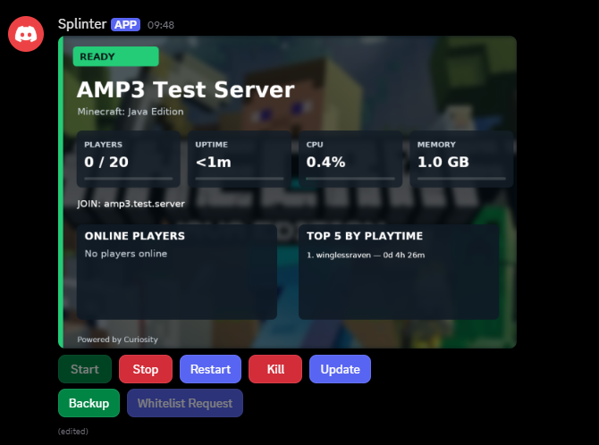
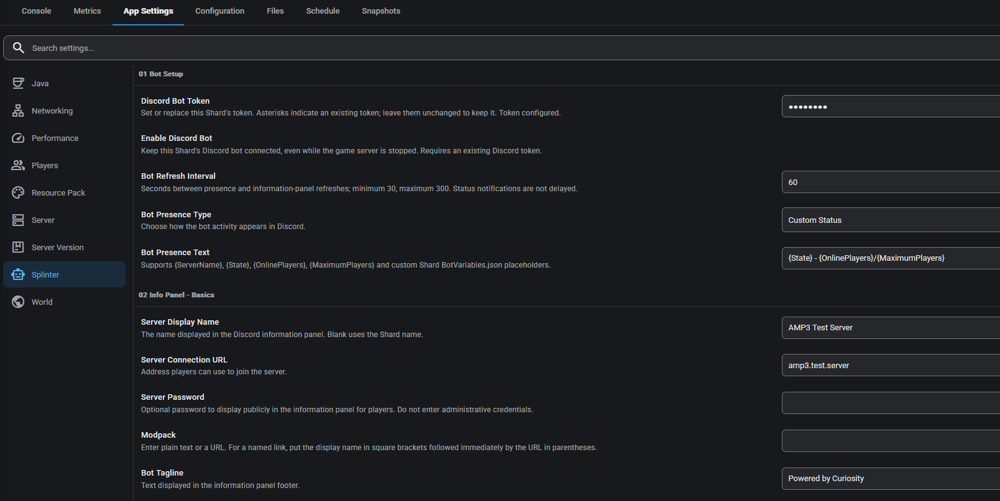

# Splinter

**A Discord integration for CubeCoders AMP 3, built around individual Shards.**

Splinter brings game-server status, control, chat, and administration into Discord. It runs inside AMP 3's persistent Web API using a single .NET 10 startup-hook plugin, with **one independent Discord bot per enabled Shard**. Bots remain online when their game servers stop. No separate Splinter service or external configuration server is required.

<p align="center"></p>

> [!IMPORTANT]
> **AMP 3 compatibility:** Developed against the AMP 3 beta (including AMP 3.0.0/3.0.1). AMP 3 does not currently provide a public plugin SDK. Splinter uses a limited compatibility layer over internal AMP services, which may change between releases. Test AMP upgrades before applying them to production.

## Features

| | Capability |
| --- | --- |
| **Per-Shard bots** | Individual tokens, presence, settings, panels and permissions; bots stay connected while game servers are offline. |
| **Pretty Panel (default)** | A generated PNG status panel with AMP/Steam game artwork, live state, player counts, CPU/RAM, server address and configured additional information. Only the real Discord action buttons appear outside the image. |
| **Classic Panel** | The alternative Discord embed layout, including thumbnail, optional local image and configurable fields. `/info` creates or refreshes the tracked panel without repeated posts. |
| **Server controls** | Role-restricted Start, Stop, Restart, Kill, Update and Snapshot/Backup actions via buttons and slash commands. Availability reflects the Shard state and AMP's supported actions. |
| **Console relay** | Send console commands from Discord and forward selected console output to a channel. AMP 3 NATS JetStream events provide low-latency updates; history polling reconciles missed events. |
| **Chat relay** | Game → Discord forwarding with experimental AMP log-level classification (`CHAT`) and Minecraft compatibility fallback. Discord → game chat is currently Minecraft-oriented. |
| **Players and playtime** | Online player names, join/leave notifications, persistent per-Shard playtime tracking and leaderboards. |
| **Whitelist requests** | Discord request/approval/denial flows with buttons and configurable approval roles. |
| **Notifications** | Server lifecycle changes and snapshot completion/failure DMs to the requester. |
| **More options** | Custom Discord presence, channel destinations, modpack references, optional Valheim join code and local HTML web-panel export. |

Splinter is configurable under **AMP → Shard → App Settings → Splinter**. Tokens use **AMP-native secret protection** rather than a separate secrets store or Windows DPAPI.

## Screenshots

### Pretty Panel — Minecraft Java


### In-AMP Configuration


## Requirements

- **CubeCoders AMP 3**, installed and running on Windows or Linux (tested primarily against beta builds).
- A **Discord application/bot for each Shard** you want to connect, with permissions to send messages, upload attachments and use slash commands.
- **Message Content Intent** in the Discord Developer Portal **only if** using Discord-to-game chat forwarding.
- For installation, administrator/root access to manage the AMP 3 Web API service. The downloaded release installer is self-contained; end users do **not** need the .NET SDK.

## Installation

1. Download the appropriate `Splinter-win-x64.zip` or `Splinter-linux-x64.zip` from [GitHub Releases](https://github.com/winglessraven/AMP-Splinter/releases).
2. Extract the entire archive, including its `payload/` directory.
3. Run the installer **from the extracted directory** with administrative privileges.
4. Open AMP 3 → your Shard → **App Settings → Splinter** to configure and enable the bot.

**Windows — PowerShell (Run as Administrator):**

```powershell
.\splinter-setup.exe install
```

**Linux:**

```bash
chmod +x ./splinter-setup  # only if your extraction tool removed executable permissions
sudo ./splinter-setup install
```

The installer discovers AMP's Web API installation and data root, safely adds Splinter to the .NET startup hooks, deploys its dependencies and restarts the AMP Web API. It preserves unrelated startup hooks and does not modify AMP 2 installations.

For nonstandard installations, specify the AMP data root and service explicitly:

```powershell
.\splinter-setup.exe install --data 'D:\AMP3\data' --service AMP3
```

```bash
sudo ./splinter-setup install --data /opt/cubecoders/amp3/data --service amp3.service
```

The usual locations are `C:\ProgramData\CubeCoders\AMP3\data` on Windows and `/opt/cubecoders/amp3/data` on Linux. **Do not use `/home/amp/.ampdata`** for AMP 3; that belongs to AMP 2.

### Configure Discord

1. Create a bot using the [Discord Developer Portal](https://discord.com/developers/applications), and invite it to your Discord server with the `bot` and `applications.commands` scopes. Grant the channel permissions needed for messages, file attachments, embeds (for Classic and notifications), and interactions.
2. In your Shard's Splinter settings, save **Discord Bot Token** and enable **Discord Bot**. Each Shard can have its own bot.
3. Run `/info` in the destination Discord channel to create the panel. Splinter tracks its channel and message automatically.
4. Configure a Discord role **name or ID** for privileged controls, and enable only the buttons/commands you want members of that role to use.
5. Optional: configure console, chat, status, player and whitelist channels. Channel values can be IDs or names as supported by the setting.

**Security:** Restrict server-control commands carefully, and keep console relay channels private: console output may disclose IPs or credentials. Splinter displays a mask for saved bot tokens and stores them using AMP's protected settings.

### Pretty and Classic panels

**Pretty** is the default for new Shards. It renders an image locally using SkiaSharp and replaces the attachment on the existing Discord message as live information changes. AMP's own Minecraft Java/Bedrock artwork is used where available; Steam templates can use their Steam App ID artwork. No game images are bundled with Splinter. A relative custom background image path can override the automatic artwork.

Pretty Panel includes enabled fields such as address, players, uptime, CPU/memory, leaderboard, modpack reference, tagline and extra text. The result is **an image plus clickable Discord buttons, not an embed**; text and links drawn inside the image are not clickable. Classic remains available from the Panel Style dropdown. If the Pretty renderer fails, Splinter falls back to Classic.

## Discord commands

Available slash commands (each can be enabled or disabled per Shard):

| Command | Action |
| --- | --- |
| `/info` | Create or refresh the information panel |
| `/start-server`, `/stop-server`, `/restart-server`, `/kill-server` | Control the game server (authorised role required) |
| `/update-server` | Request an AMP update operation |
| `/console` | Submit a game-console command |
| `/take-backup` | Create an AMP 3 snapshot and receive a completion/failure DM |
| `/playtime`, `/full-playtime-list` | View tracked player playtime |

Other workflows, including whitelist approvals, can be performed through configured Discord buttons and channels. Some AMP actions may be unavailable for particular games or Shard states.

## Updating, diagnostics and removal

Run commands from a **newly extracted release package**, so `splinter-setup` finds the matching `payload/` directory.

| Action | Windows (elevated PowerShell) | Linux (root) |
| --- | --- | --- |
| Update | `.\splinter-setup.exe update` | `sudo ./splinter-setup update` |
| Check installation | `.\splinter-setup.exe doctor` | `sudo ./splinter-setup doctor` |
| Uninstall | `.\splinter-setup.exe uninstall --yes` | `sudo ./splinter-setup uninstall --yes` |

Updates retain existing Shard configuration, AMP-protected token files, registered panel messages, player history and pending snapshot notifications. Uninstall removes Splinter's hook and plugin binaries **but leaves its persistent data intact** for reinstallation. Back up AMP data and secret protection keys before moving or rebuilding an installation; encrypted secrets require their matching AMP keys.

Splinter logs are stored under the AMP 3 data root at `splinter/logs/splinter.log` (on a typical Linux installation: `/opt/cubecoders/amp3/data/splinter/logs/splinter.log`). Check AMP's own service logs if the Web API cannot start. The `doctor` operation is read-only.

## Build from source

Development requires the **.NET 10 SDK**. The public solution includes the host plugin and setup utility:

```powershell
dotnet build .\Splinter.sln -c Release
```

Build installer packages for Windows and Linux:

```powershell
dotnet run --project .\Splinter.Installer -c Release -- package
```

Packages are written to `dist/` (ignored by Git). Supported default targets are `win-x64` and `linux-x64`, with `win-arm64` and `linux-arm64` available through `--rids`.

Maintainer-only regression suites are kept locally under `tests/` and are not distributed with this public source checkout. If both local suites are present, the packager runs them before producing releases; a clean public checkout builds and packages without them. Maintainers can run them independently:

```powershell
dotnet run --project .\tests\Splinter.NativeSettings.Tests -c Release
dotnet run --project .\tests\Splinter.Installer.Tests -c Release
```

No additional bot process, service or secrets configuration is needed: Splinter loads into AMP 3's existing Web API through `DOTNET_STARTUP_HOOKS` and uses AMP's native service infrastructure. Because the AMP integration relies on internal APIs, verify compatibility after every AMP update.

## Scope and limitations

Splinter is the AMP 3 successor to the original **AMP-Discord-Bot**. It aims to preserve the core workflows while adapting to AMP 3's Shards, native settings, snapshots and message bus. Chat relay and server-command support remain game-dependent where AMP does not provide a generic event or command abstraction. `CHAT` log-level classification is experimental in current AMP 3 beta builds; the Minecraft compatibility path remains enabled when no explicit level is configured.

Splinter is community-developed and is **not an official CubeCoders AMP plugin**. Keep an AMP backup and verify host compatibility before upgrading beta versions.
